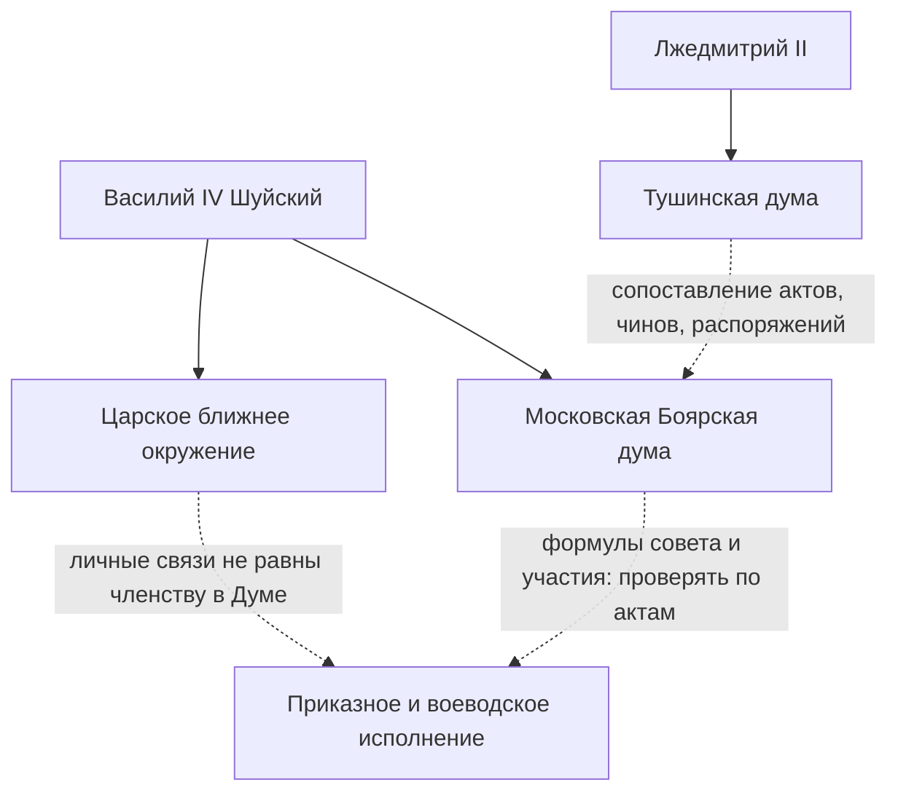
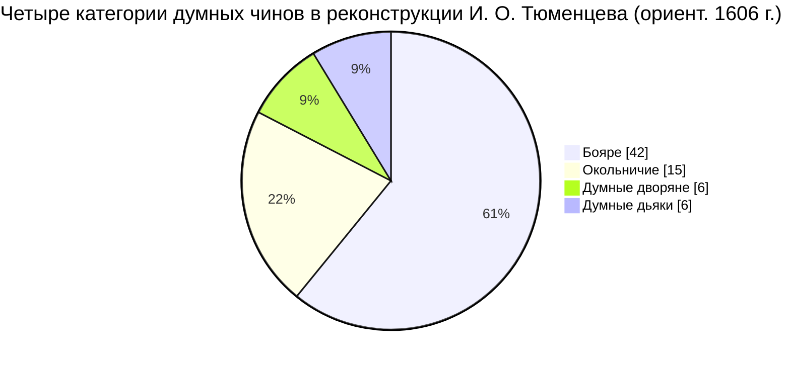
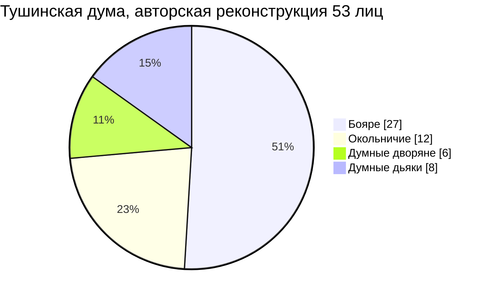
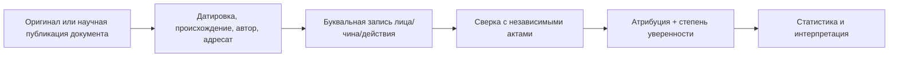

# Наглядные элементы — без выдуманной статистики

## 1. Институциональная схема (исследовательская модель, не буквальная схема командования)

Оговорка: линии отражают **аналитические вопросы и исторически существовавшие политические центры**, а не доказанную процедуру из конкретного акта.

## 2. Думные чины в начале правления Шуйского: данные И. О. Тюменцева

**Источник:** Тюменцев И. О. *Смутное время...* М., 2008, с. 336–338 (печатную пагинацию сверить). Это 69 позиций по четырём категориям, **не** подтверждённое число заседателей в конкретный день.

## 3. Тушинская дума: данные И. О. Тюменцева

**Источник:** Там же, табл. 4, с. 360. В восстановлении использованы в том числе косвенные сведения; **не** показывать эти цифры как численность на одну дату и не проводить на их основании «долю перешедших из Москвы» без персонального сопоставления.

## 4. Источниковедческая процедура

Если один этап не выполнен, следующий отмечается **предварительным**. Запрещается подменять отсутствующие документы реконструкцией без указания её статуса.

## 5. График готовности

**Не строить** выдуманные проценты готовности диссертации и «охват источников», пока не заведены прозрачные реестры количества просмотренных актов/изданий. Для отчётности нагляднее таблица **сделано / не сделано** с явным основанием и датой.
